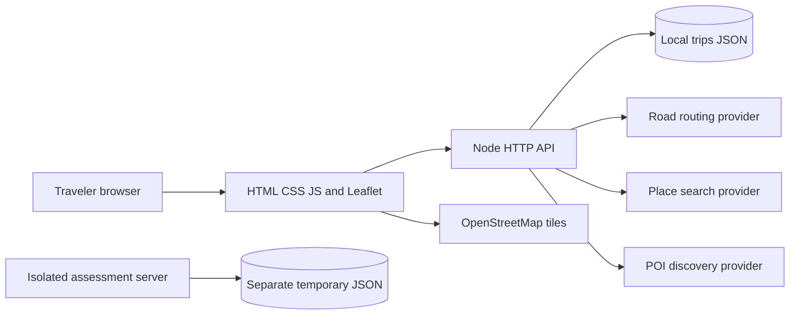
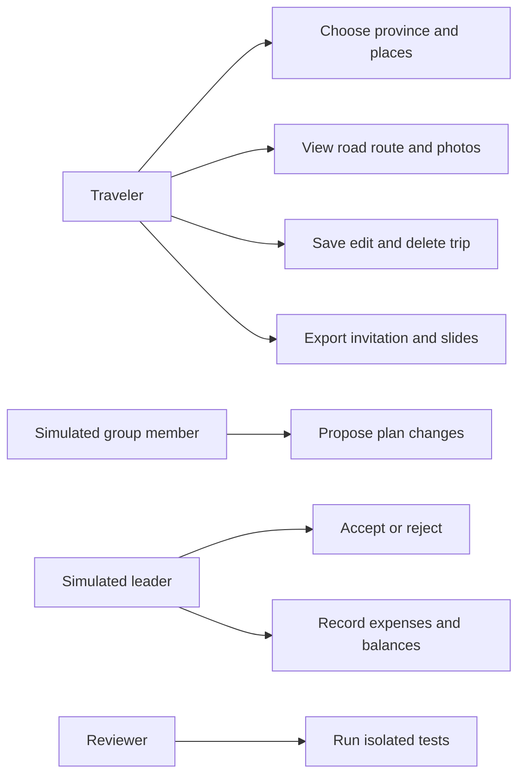
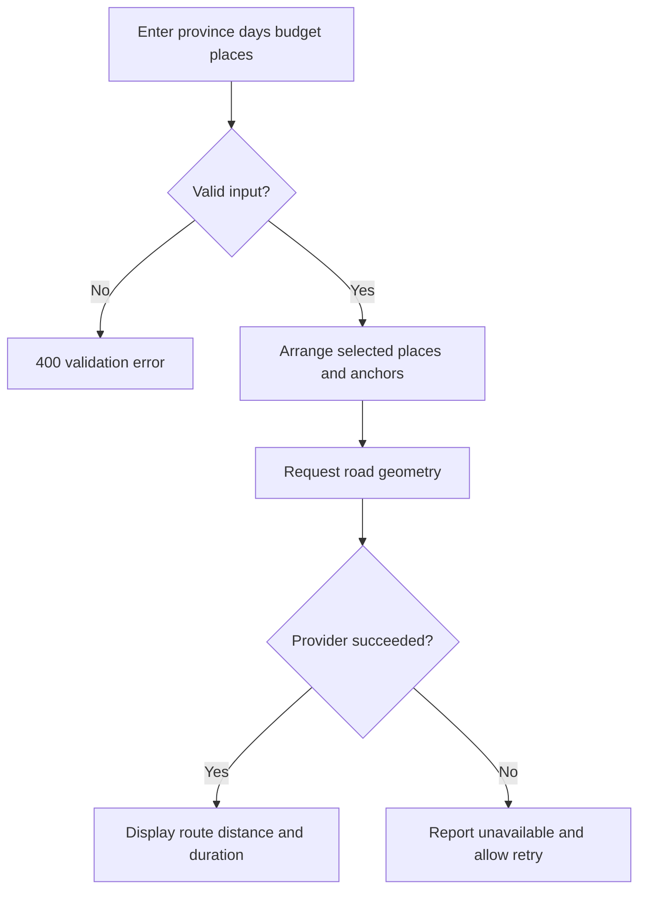
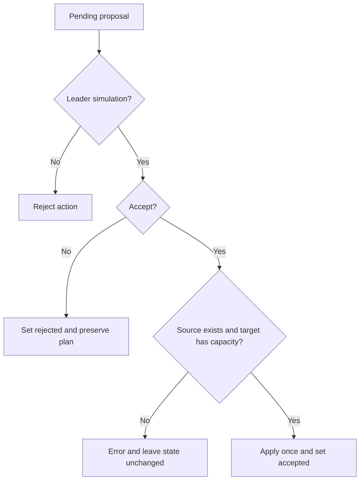
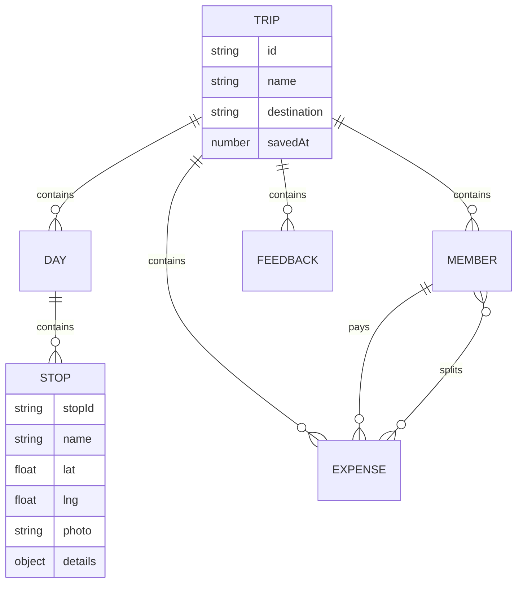
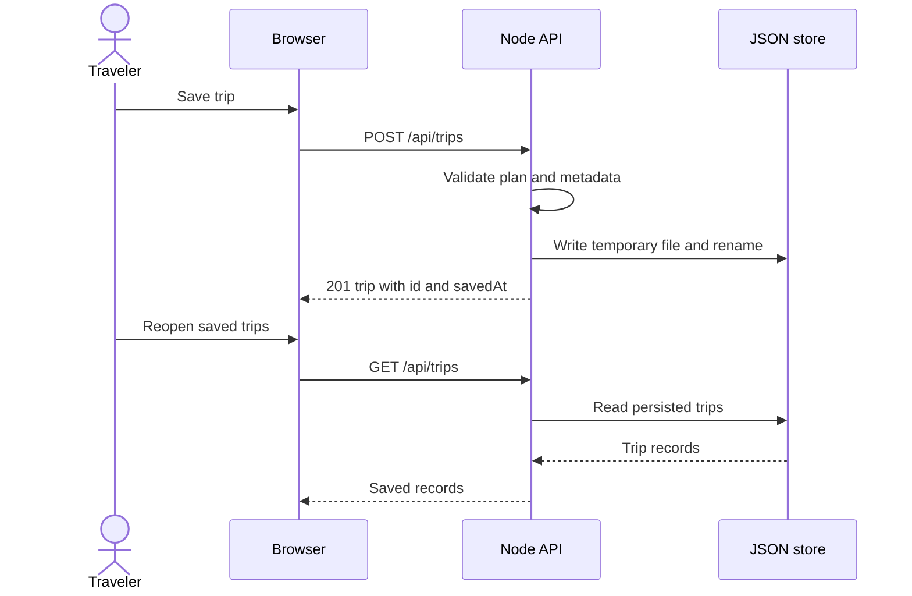
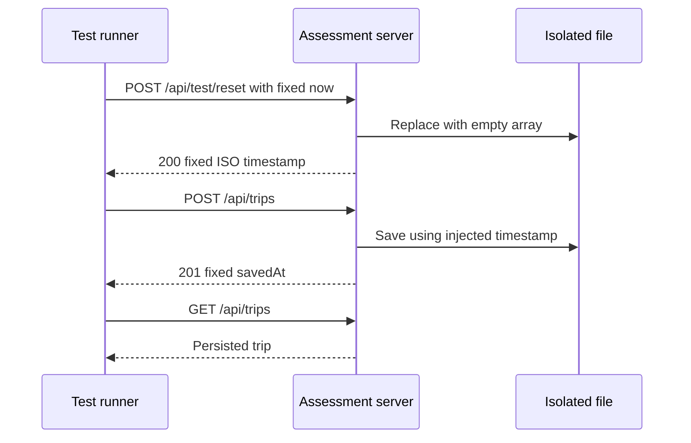

# LAB 3 — System design

สถาปัตยกรรมที่มีจริง Node + JSON; Mermaid source ยังไม่มีหลักฐาน render ด้วย Mermaid CLI. ERD เป็น logical model ของ nested JSON ไม่ใช่ schema PostgreSQL.

## Architecture

## Use cases

## Flow 1 — Plan and road route

## Flow 2 — Feedback decision

## Logical ERD

## Sequence 1 — Save and reopen

## Sequence 2 — Isolated assessment

Security boundary: localhost service ไม่มี login; friend/leader เป็น UI simulation และไม่ใช่ authorization boundary. Atomic rename ลด partial-file writes แต่ไม่ใช่ database transaction/lock และไม่รับรอง concurrent writes.
